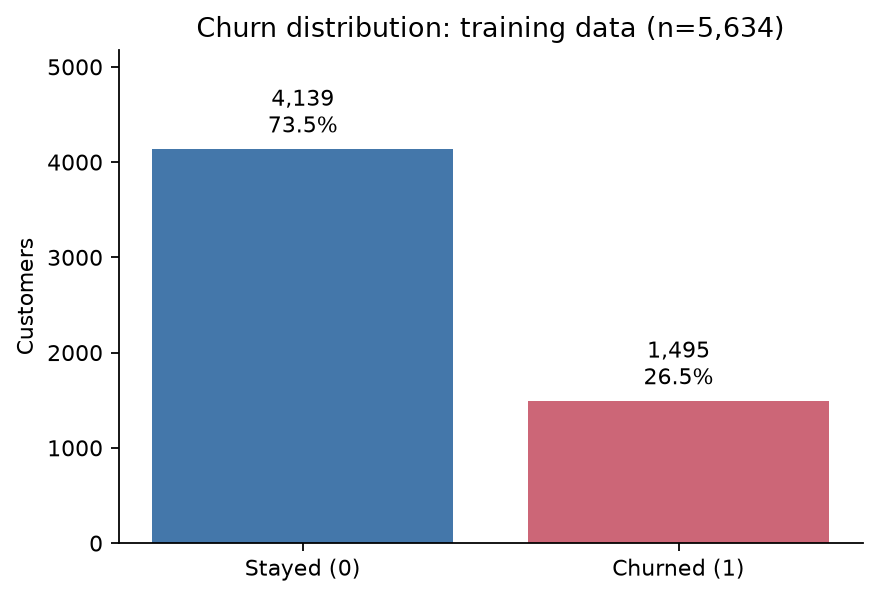
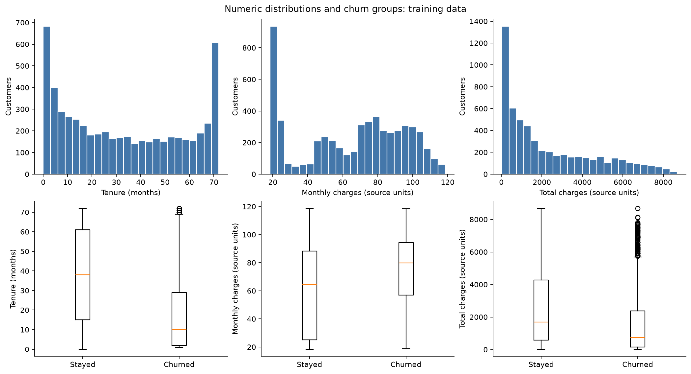
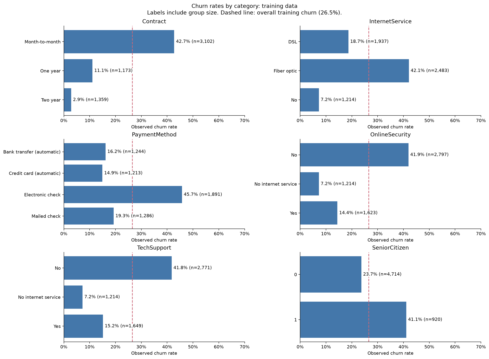
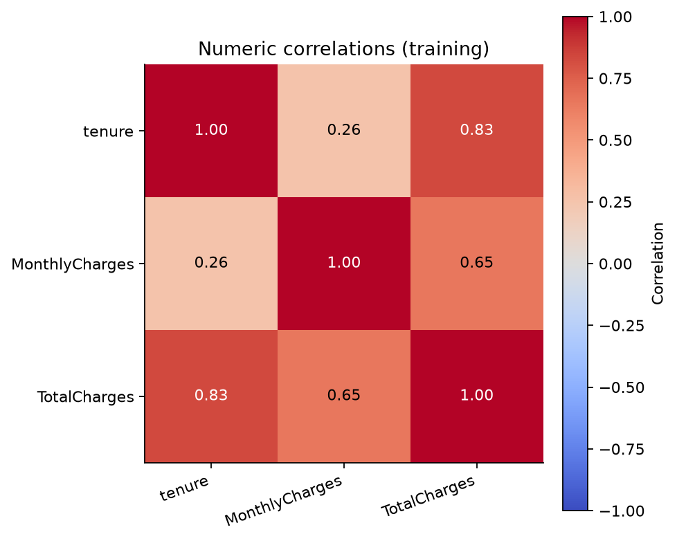

# Dataset inspection and EDA findings

Analysis date: 10 November 2026. These are measured descriptive results and AI interpretations, not model evaluation scores. Feature-to-target analysis uses only the 5,634 training records. The 1,409 reserved test records have not been used for EDA.

## Measured findings

- Training contains 1,495 churned customers (26.54%) and 4,139 who stayed. The majority-class training proportion is 73.46%. Accuracy alone could conceal missed churners.
- Month-to-month customers have an observed churn rate of 42.75%, compared with 11.08% for one-year and 2.87% for two-year contracts. Group sizes and numerators appear in categorical_churn_rates.csv.
- Median tenure is 10 months among churned customers and 38 months among those who stayed.
- Median monthly charges are 79.95 among churned customers and 64.40 among those who stayed, in the source's charge units.
- There are 8 missing total-charge values in training. Histograms, boxplots and numeric summaries omit missing values for that field; group denominators remain the full category counts.
- Tenure and TotalCharges have Pearson correlation 0.829 in training, calculated on observed pairs.

## Interpretation and preparation decisions

Contract and tenure show associations with churn in this training sample. These comparisons do not establish that a contract change or retention offer would prevent churn. Monthly and accumulated charges measure different aspects of the account, and accumulated charges are related to tenure. Retain all three numeric predictors initially and assess the models with training cross-validation.

Keep the original data unchanged. Retain distinct customer IDs even where profiles match. Exclude the identifier from predictors and encode the target separately. Preserve valid service-absence categories. Keep SeniorCitizen categorical. Numeric scaling is planned for KNN and logistic regression; it must be fitted inside their training pipelines.

The full-file audit found 11 blank total-charge strings, all on records with zero tenure. This pattern does not prove the correct replacement value. Retain them as missing and plan median imputation within training folds. Extreme values in the displayed distributions are retained because no verified data error has been established.

## Ethics and limits

Publish aggregate tables and code; keep customer-level records local. Gender and the senior-citizen indicator need scrutiny when evaluating subgroup errors later. Observed group churn rates alone do not establish model fairness. Consider whether these fields are appropriate for the intended use and explain that decision before deployment.

Kaggle describes the target as customers who left within the last month. This is a static sample without verified observation dates or prospective follow-up. Predictor availability at decision time remains an assumption. Later test performance will describe this held-out sample, not prove performance on future customers. The source metadata does not establish a representative deployment population.

## Evidence and next step

Tables and four figures in this folder are generated by explore_data.py. The source checksum, split seed and partition hashes are recorded in results/split_summary.json. The data dictionary and provenance are in data/DATASET.md.

Next: construct leakage-safe model pipelines, fit all three baseline classifiers, and agree how the brief's undefined "both model experimental settings" should be interpreted. No models, performance scores or post-deployment monitoring have been implemented in this milestone.

## Figures

References: [specified Kaggle dataset](https://www.kaggle.com/datasets/blastchar/telco-customer-churn); [scikit-learn leakage guidance](https://scikit-learn.org/stable/common_pitfalls.html).
